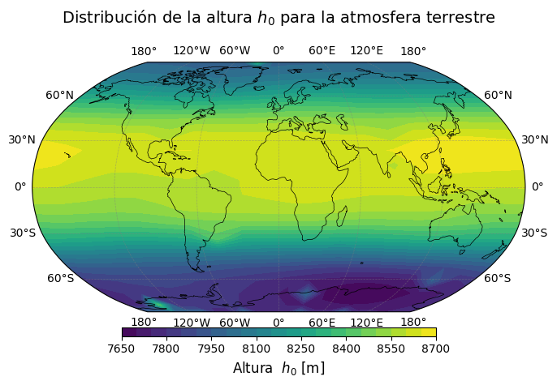
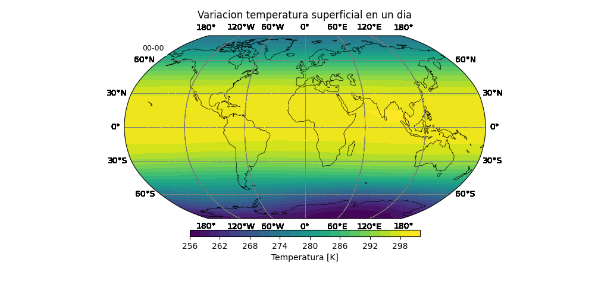
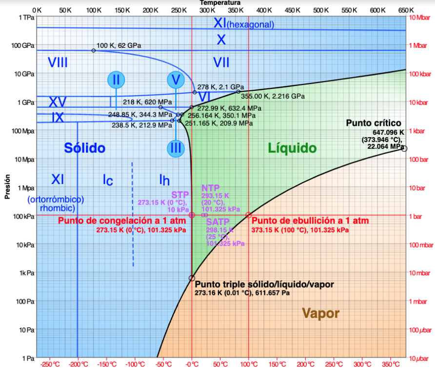
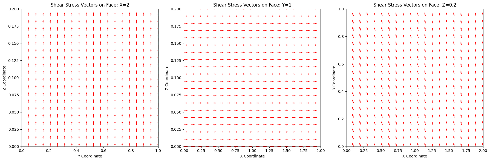
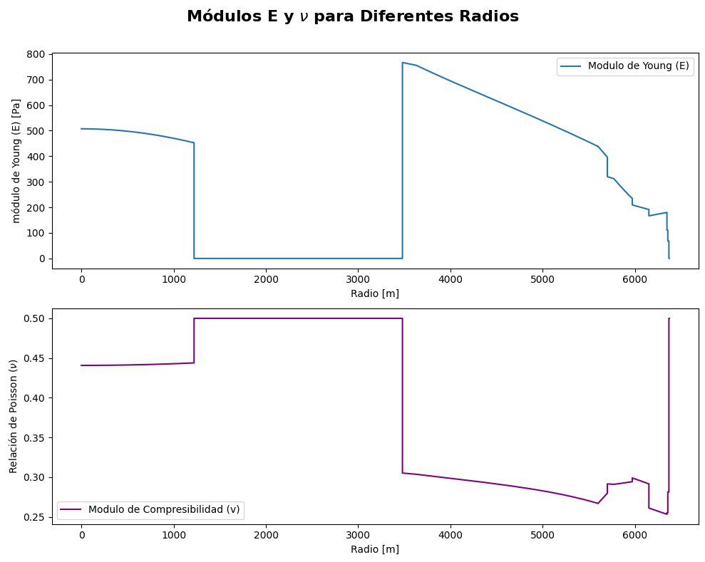

# Continuum Mechanics

Course results, shown from the figures in [`figures/`](figures).

## Ideal gas

Particles in a box. [Notebook](Homeworks/MCON_Tarea1_ModeloNumericoDeUnGas.ipynb).

<video src="figures/ideal_gas_simulation.mp4" controls width="640"></video>

[ideal_gas_simulation.mp4](figures/ideal_gas_simulation.mp4)

## Atmosphere

Scale height \(h_0\) of a homentropic fit, and surface temperature through one day. [Notebook](Homeworks/MCON_Tarea2_AtmósferaEmpírica.ipynb).

| Scale height \(h_0\) | Surface temperature, one day |
| --- | --- |
|  |  |

## Water phase diagram

Solid, liquid, and vapor. [Ocean notebook](Homeworks/Cuaderno_MCON_OceanoPlanoParalelo_Clase.ipynb).

## Stress and elasticity

Shear on three faces of a block, and Young’s modulus \(E\) with Poisson’s ratio \(\nu\) inside the Earth. [Stress notebook](Homeworks/MCON_Tarea3_TensorDeEsfuerzosYDeformación.ipynb) · [Elastic moduli](Homeworks/mini_homework_elactic_modules_Earth.ipynb).

| Shear stress | Elastic moduli vs radius |
| --- | --- |
|  |  |

## Gravitational collapse

SPH particles falling into a star. [Notebook](Homeworks/Cuaderno_MCON_CFDEjemploSPH_Clase_2024_1.ipynb).

<video src="figures/gravitational_collapse.mp4" controls width="640"></video>

[gravitational_collapse.mp4](figures/gravitational_collapse.mp4)
